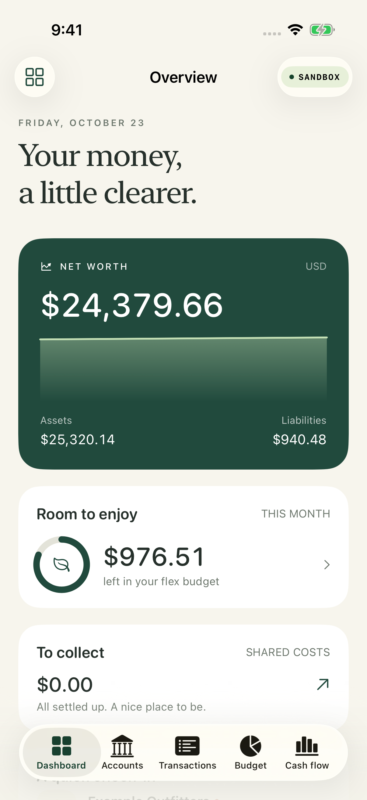
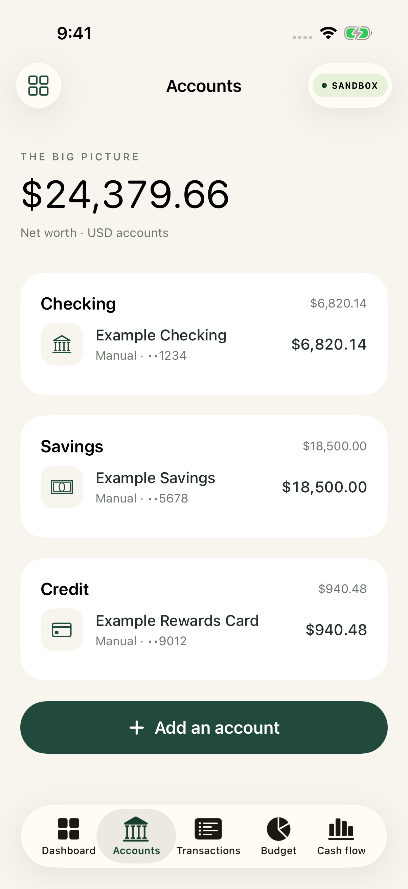

# Monarch Personal · Swift iOS Sandbox · v0.2

A native SwiftUI / SwiftData personal finance app based on the supplied PRD, with a stateless FastAPI Plaid proxy. The app currently accepts **Plaid Sandbox only**. It starts with an empty ledger, not fabricated bank data.

The updated PRD's **F45–F56** are implemented in source: receipts, email scanning, camera/Share imports, HSA records and exports, and shipment tracking. Follow [the new feature setup and acceptance guide](docs/RECEIPTS-HSA-SHIPMENTS.md) for service configuration, signing, and native testing.

To connect your own developer account, follow [Plaid Sandbox and FastAPI setup](docs/PLAID-SETUP.md). It covers signup, GitHub secret entry, live API verification without a Mac, and the Render service.

**No Mac of your own?** The included [GitHub cloud build and screenshot workflow](docs/CLOUD-SCREENSHOTS.md) runs Xcode and an iPhone simulator on a hosted Mac. A successful run has compiled the app and extensions and exported ten real simulator captures with explicit example data. See [the verification record](docs/VERIFICATION.md) for the run and platform details.

[View all ten simulator screenshots](docs/screenshots/README.md) · [Successful GitHub build](https://github.com/aali234/Monarch-ios/actions/runs/39900373095)

<p>
<a href="docs/screenshots/01-Dashboard-example-data.png"></a>
<a href="docs/screenshots/02-Accounts-example-data.png"></a>
</p>

## Run on an iPhone simulator

You need a **Mac, Xcode 26 or newer, an iOS 26+ iPhone Simulator runtime, Python 3.12+, and a free Plaid developer account**. The unsigned simulator path supports the local ledger, receipt file imports and Sandbox banking. Share Extension/App Group and iCloud testing need the signing/capability setup in the new feature guide.

1. Create/verify your account at [Plaid Dashboard](https://dashboard.plaid.com/signup). In the Dashboard’s API keys area, find your client ID and **Sandbox** secret. The account signup and email verification need your browser; no account was created by this implementation session.
2. On your Mac, open Terminal in this folder and run:

   ```bash
   ./scripts/run-proxy.sh
   ```

   The first run creates `proxy/.env` with a generated app key and exits. Open that file in your editor, fill in `PLAID_CLIENT_ID` and `PLAID_SECRET`, and keep `PLAID_ENV=sandbox` and `ENABLE_SANDBOX_TOOLS=true`. Run the same command again and leave it running. Never put the Plaid secret in the iOS project or in chat.
3. In another Terminal window in this folder, run:

   ```bash
   ./scripts/run-simulator.sh
   ```

   This resolves LinkKit, builds the app, starts an available iOS 26+ iPhone simulator, and installs/launches the app. You can also open `Monarch.xcodeproj`, choose the `Monarch` scheme and an iPhone simulator, then press Run. If several simulators are available, set `MONARCH_SIMULATOR_UDID` to select one.
4. In the app, tap the grid button → **Settings & connections**. Keep the proxy URL `http://127.0.0.1:8000`, enter the `APP_KEY` from `proxy/.env`, and tap **Save & test connection**.
5. Add an account. For the quickest complete data-path test, tap **Add Sandbox test bank instantly**. To test the login UI, tap **Connect with Plaid**, choose a non-OAuth institution such as **First Platypus Bank**, and use `user_good` / `pass_good` (MFA code `1234` if requested). For changing transaction data use `user_transactions_dynamic` with a nonblank password.
6. If history is preparing, wait a few seconds, then pull to refresh on Dashboard, Accounts, or Transactions. The initial Plaid sync can be empty while history is generated; the app does not replace it with sample transactions.

The instant test button uses First Platypus Bank for transactions, First Gingham Credit Union for liabilities, and Tartan Bank for investments, so the duplicate guard does not confuse the three tests. Each connection initializes its selected product. Choose the corresponding product in the add-account sheet.

## What is implemented

- Five native tabs: dashboard, accounts, transactions, budget, cash flow; a More menu for supporting screens.
- Manual accounts, independent calculation visibility, archiving, balance reconciliation, daily snapshot upserts.
- Plaid LinkKit **7.2.3**, new connection and update mode, duplicate metadata guard **before token exchange**, Keychain token storage with connection recovery, account sync, paginated transaction sync and incremental updates.
- Pending → posted reconciliation preserves local edits; modified and removed transactions are processed; cursor and ledger writes commit together. Pagination mutations restart from the original cursor.
- Transaction search, filters, day grouping, swipe review, merchant/category/date/notes/tags editing, exact category splits, protected manual edits.
- CSV file picker, column mapping, validation preview, per-account import profiles, SHA-256 identities and duplicate skipping.
- Editable categories/groups/buckets; ordered rules with a live preview and optional application to existing transactions. The editor covers common merchant/description/amount/account/direction matches and category, rename, tag, review, hide, loan and shared-cost actions.
- Flex/category budgets, monthly plans, category and flex rollovers, starting balances, posted-expense actuals and refund handling.
- People and aliases, shared charges and manual IOUs, request copy/share, partial payments, write-offs, exact auto-settlement, confirmation of other matching deposits, and credits for manual overpayment allocation.
- Cash-flow periods, breakdowns, a flow diagram, recurring detection with confirmation, manual/student loan payoff estimates, Plaid liabilities and investment holdings.
- Four deterministic health checks and an aggregate scenario forecast with editable assumptions and saved milestones.
- Face ID/device-passcode lock, app-switcher obscuring, protected local store excluded from device backup, explicit encrypted export/restore through Files (including iCloud Drive). AES-256-GCM; PBKDF2-HMAC-SHA256 with a random salt and 600,000 rounds. Tokens and app keys are excluded.
- Receipt PDFs/images/email/text, VisionKit document scan, on-device OCR and structured Foundation Models extraction where available, editable fields/line items, exact transaction matching and near-match suggestions.
- Gmail read-only OAuth and TLS IMAP clients, 90-day initial scans and incremental foreground/background scans; a Share Extension with a protected App Group inbox.
- Original receipt files and image/email PDF copies, organized by year/month in iCloud Drive with protected local fallback. Receipt contents are encrypted by default; an explicit setting allows future files to be ordinary documents in Files.
- User-confirmed HSA eligibility, reimbursement dates/withdrawal links, yearly totals, and local ZIP + CSV exports.
- Shipment cards, optional proxy carrier timelines, two-hour lookup gate, delivered archive, opt-in notifications and a delivery Live Activity extension.
- Backup archive v2 includes receipt/shipment metadata and the receipt vault key inside the passphrase-encrypted archive, with file-data or verified iCloud-link options. Mail/Plaid credentials remain excluded; v1 backups remain readable.

Aggregated budgets, cash flow, and net worth are USD-only; other-currency accounts are displayed separately without assuming a conversion rate. Manual/imported transactions do not change account balances automatically; reconcile balances separately.

## Verification and remaining gates

This project was authored in a **Linux** workspace. The portable Swift package and proxy tests were executed here, and the app was then built and launched on a **GitHub-hosted Mac** with Xcode 26.3 and the iPhone 17 Pro simulator running iOS 26.2.

The latest portable checks pass **26 Swift tests and 29 proxy/verifier tests**. The generated ZIP format was independently checked with Python. See [the verification record](docs/VERIFICATION.md) for the precise boundaries of these checks.

**The Apple SDK build and screenshot UI test pass.** The test launches the real app, loads the SwiftData models in memory, navigates ten example-data screens, and saves 1206 × 2622 PNGs. The ten native unit tests and the manual-account UI smoke test were compiled but were not executed by this screenshot-only job. Run the full suite for the separate persistence, backup crypto, Keychain and receipt-vault checks:

```bash
./scripts/test.sh
xcrun simctl list devices available
MONARCH_SIMULATOR_UDID=<your-ios-26-or-newer-iphone-uuid> ./scripts/test-ios.sh
```

Then follow [the Sandbox acceptance checklist](docs/SANDBOX-TESTING.md). No Plaid account credentials were available here, so **no live Plaid API call or successful bank Link has been claimed**. Optional live API smoke checks, once your local server is configured:

```bash
cd proxy
.venv/bin/python sandbox_smoke.py
.venv/bin/python sandbox_smoke.py --product liabilities
.venv/bin/python sandbox_smoke.py --product investments
```

See [implementation scope and deviations](docs/IMPLEMENTATION.md) for the remaining PRD work. Production linking is blocked in the app. The broader AI assistant/categorization/recap, Siri, goals/avalanche-snowball planning, home-screen budget widgets, FinanceKit, scheduled bank sync, automatic weekly iCloud backup, full account-by-account forecasting, advanced saved reports and navigation customization remain future work. Receipt extraction uses the on-device model; there are no third-party AI calls. This remains a Sandbox milestone with native/live acceptance gates.

## OAuth and remote proxy

Start with the non-OAuth Sandbox institutions above. OAuth banks require a registered **HTTPS redirect URI**, Associated Domains entitlement, and a hosted `apple-app-site-association` file. Set `PLAID_REDIRECT_URI` on the proxy and finish that Apple/Plaid setup before testing OAuth; the unsigned local simulator setup does not provision it for you. See [Plaid iOS Link](https://plaid.com/docs/link/ios/) and [OAuth setup](https://plaid.com/docs/link/oauth/).

The root `render.yaml` defines a free Render service with `rootDir: proxy`. Set `PLAID_CLIENT_ID` and the Sandbox `PLAID_SECRET` during Blueprint creation; Render generates `APP_KEY`. Follow [the setup guide](docs/PLAID-SETUP.md) for hosting, remote API verification and pairing the iOS app. No Render deployment or live Plaid verification has been completed yet. The shared app key is a single-user prototype control, not a replacement for production user authentication/App Attest.

## Project layout

| Path | Purpose |
| --- | --- |
| `Monarch.xcodeproj` | Five targets: app, Share Extension, Live Activity, native unit and UI tests |
| `Monarch/` | SwiftUI app, SwiftData models, Keychain, sync writer, encrypted backups |
| `MonarchShare/`, `MonarchActivity/`, `Shared/` | Extension UI, shared inbox and Activity attributes |
| `MonarchCore/` | Dependency-free portable Swift logic, API DTOs/client, and tests |
| `proxy/` | Stateless Plaid/optional tracking server, tests, local config and live verifiers |
| `render.yaml` | Free Render deployment with the proxy root directory and generated app key |
| `scripts/` | Local launch, tests, and reproducible Xcode-project generation |

After adding/removing source files, regenerate the checked-in project with `python3 scripts/generate-project.py`. No XcodeGen, CocoaPods, or third-party account storage is required.
