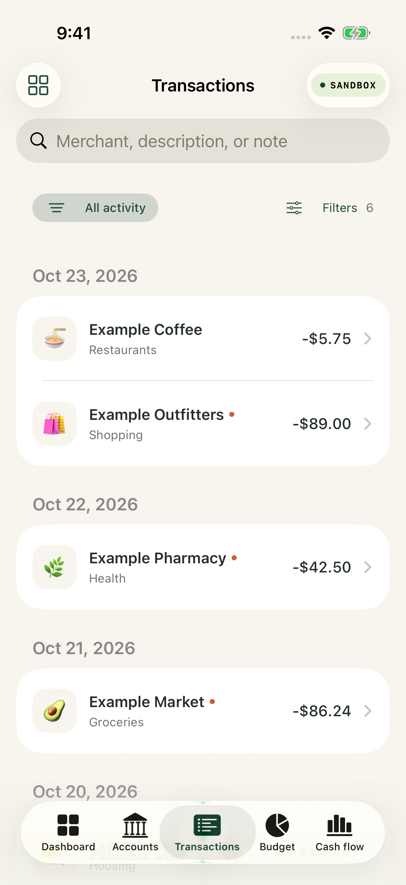
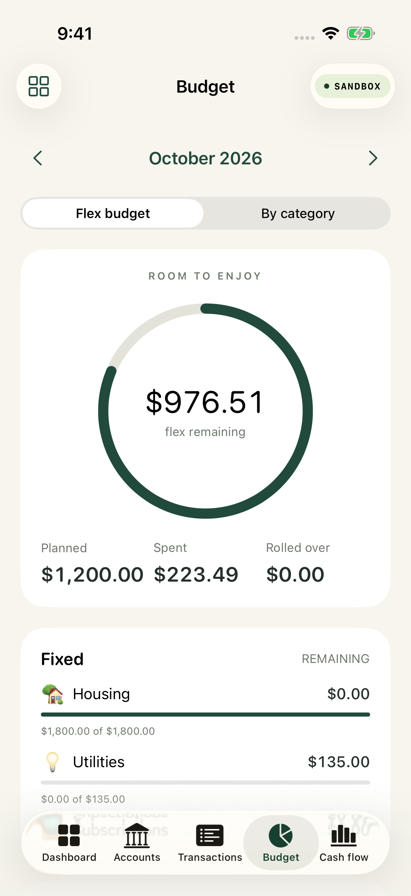
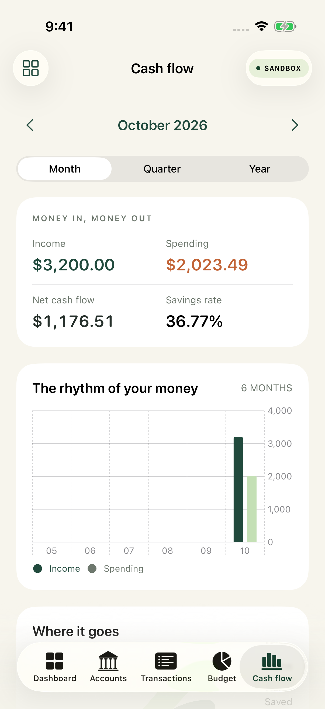
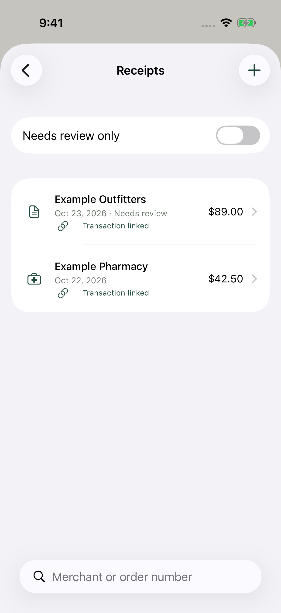
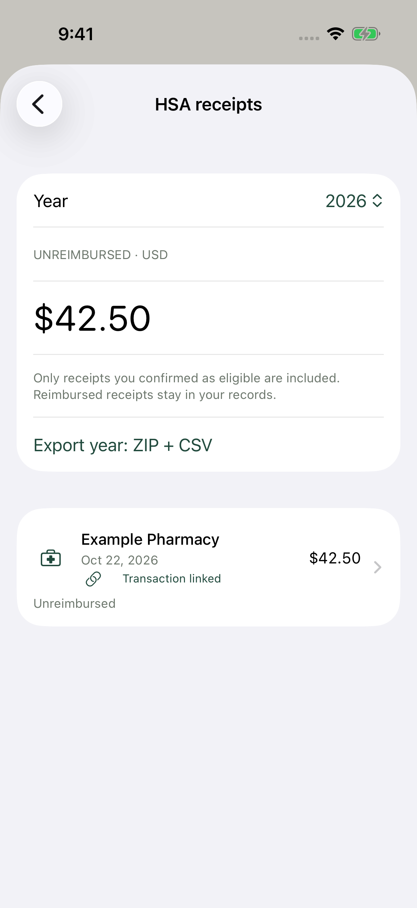
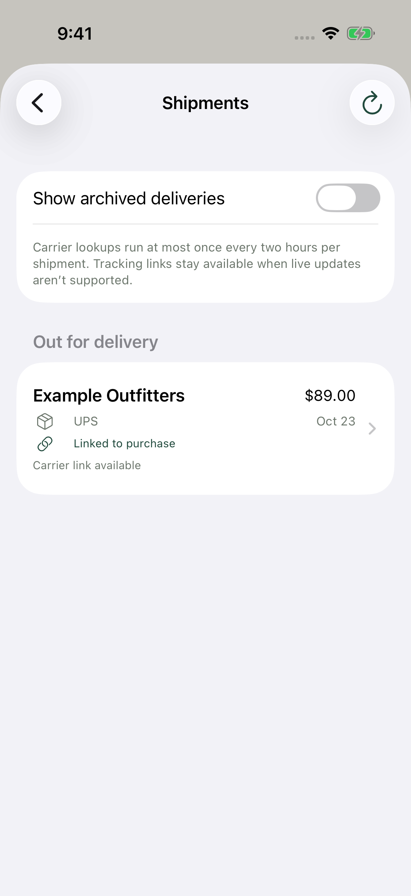
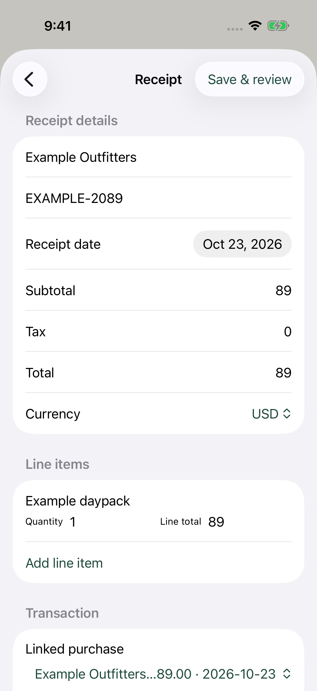
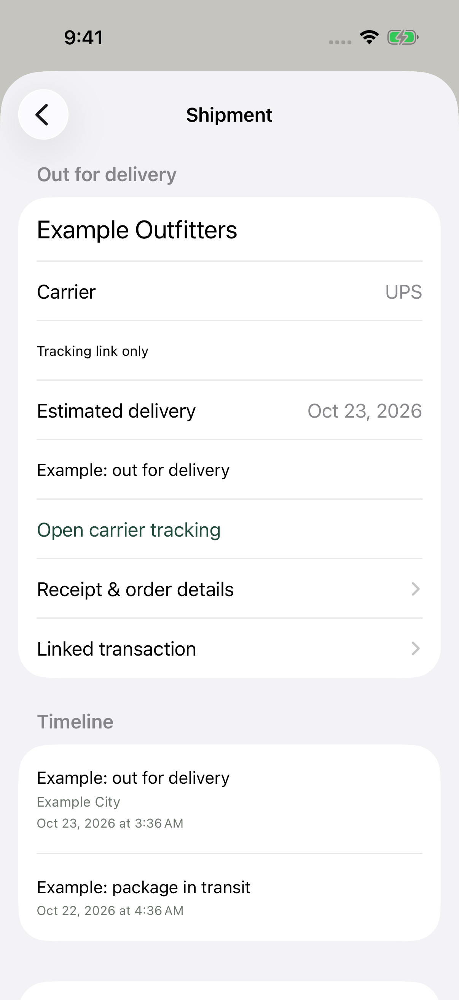

# iPhone Simulator screenshots

Ten real screenshots from the native SwiftUI app on **iPhone 17 Pro / iOS 26.2 / Xcode 26.3**. All financial, receipt and shipment data are synthetic examples in an in-memory ledger.

[Successful native build and screenshot test](https://github.com/aali234/Monarch-ios/actions/runs/39900373095) · tested commit `f921e8ad2626782e94d458078e32f25650456f9f`.

Open a PNG below, or download this folder with the source and open `index.html` for an offline gallery. The PNGs retain their original 1206 × 2622 pixels and bytes; only the filenames have been made readable. `manifest.json` records the source attachment names and SHA-256 checksums. Live Plaid, mail, camera, signing/iCloud and carrier acceptance checks are listed in [the verification record](../VERIFICATION.md).

| Screen | PNG |
| --- | --- |
| Dashboard | [01-Dashboard-example-data.png](01-Dashboard-example-data.png) |
| Accounts | [02-Accounts-example-data.png](02-Accounts-example-data.png) |
| Transactions | [03-Transactions-example-data.png](03-Transactions-example-data.png) |
| Budget | [04-Budget-example-data.png](04-Budget-example-data.png) |
| Cash flow | [05-Cash-flow-example-data.png](05-Cash-flow-example-data.png) |
| Receipts | [06-Receipts-example-data.png](06-Receipts-example-data.png) |
| HSA receipts | [07-HSA-receipts-example-data.png](07-HSA-receipts-example-data.png) |
| Shipments | [08-Shipments-example-data.png](08-Shipments-example-data.png) |
| Receipt details | [09-Receipt-details-example-data.png](09-Receipt-details-example-data.png) |
| Shipment timeline | [10-Shipment-timeline-example-data.png](10-Shipment-timeline-example-data.png) |

